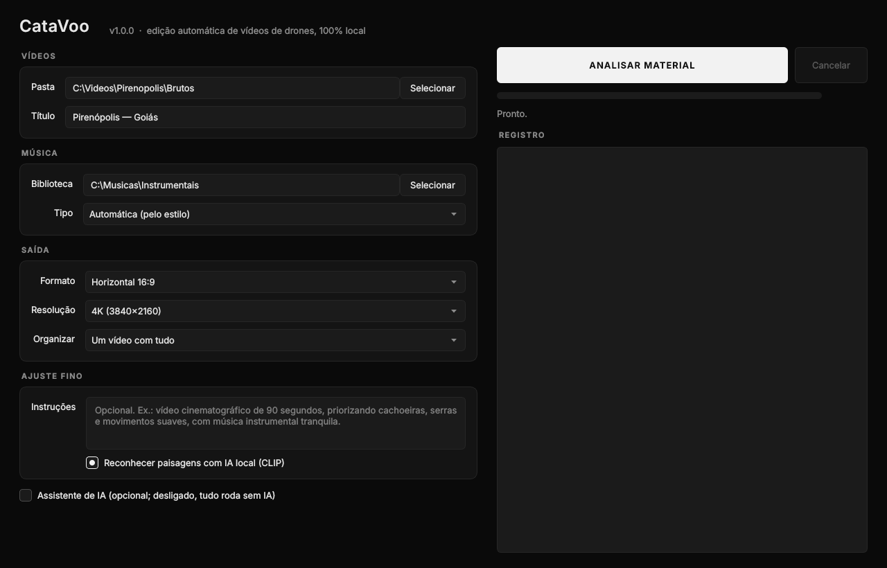
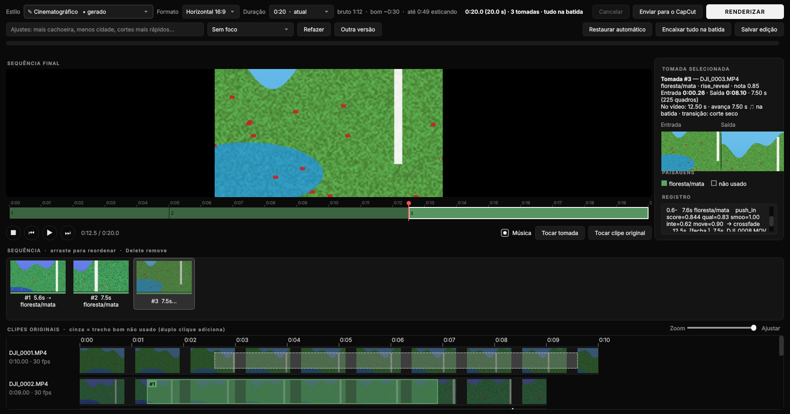

  

<h1 align="center">DroneHighlighter</h1>

  <b>Transforma pastas de vídeos brutos de drone em vídeos cinematográficos, sozinho e no seu PC.</b> 
  Grátis, código aberto (AGPL-3.0), 100% local. Sem nuvem, sem assinatura, sem chave de API.

  
  
  

---

Você volta de uma viagem com 40 minutos de filmagem aérea em 4K e quer um vídeo de 1 a 2 minutos
que dê vontade de assistir. O DroneHighlighter assiste tudo por você: descarta o que tremeu, ficou
escuro ou repetiu, escolhe as melhores tomadas, monta no ritmo da música e entrega o vídeo pronto em
**16:9 (até 4K)** e **9:16** para Reels, Shorts e TikTok.

  

## O que ele faz

**Entende a filmagem de drone**
- **Separa tremedeira de movimento.** Um giro lento e uma órbita são bons; uma rajada de vento não.
  O programa mede a estabilidade de cada trecho e reconhece panorâmica, órbita, aproximação e
  subida.
- **Pontua cada tomada** por nitidez, exposição, suavidade, interesse visual e movimento.
- **Elimina cenas repetidas**, para o vídeo não mostrar a mesma cachoeira três vezes.
- **Reconhece a paisagem** (cachoeira, serra, rio, mata, cidade histórica, pôr do sol…) com uma IA
  local opcional (CLIP), instalada com um clique.

**Monta como um editor**
- **11 estilos**: cinematográfico, contemplativo, trailer épico, aventura FPV, diário de viagem,
  pôr do sol, redes sociais e outros. O **Automático** analisa a viagem e escolhe o estilo.
- **Cortes na batida da música**, com fade-out no final.
- **Duração automática** ou escolhida por você, com aviso quando falta material bom.
- **Um vídeo por voo, dia, local ou pasta**, e um resumo da viagem inteira.
- **Não gostou?** Escreva o ajuste ("mais cachoeira, cortes mais rápidos") e clique em *Refazer*,
  ou peça *Outra versão*. Tudo sem IA paga.

**Edição manual: um mini editor**
- O monitor toca o vídeo final com a música **sem renderizar nada**.
- Ajuste cada tomada **quadro a quadro**, arraste para reordenar e troque de estilo na hora.
- Dê dois cliques numa tomada para tocá-la em loop enquanto você a ajusta.
- **Enviar para o CapCut**: as tomadas saem cortadas no quadro exato e numeradas na ordem, junto
  com a música, prontas para o acabamento.

  

**Do seu jeito**
- Funciona **sem internet e sem chave de API**. O assistente de IA (Ollama ou LM Studio locais,
  ou OpenAI e Claude pagos) é **opcional e vem desligado**.
- Usa a placa NVIDIA para exportar mais rápido, se houver.
- Os vídeos originais nunca são alterados.

## Baixar e usar (Windows)

1. Baixe o `.zip` da [versão mais recente](https://github.com/italocarlos1-cpu/VideoHighlighter/releases/latest)
   e extraia numa pasta.
2. *(Recomendado, uma vez só)* Dê dois cliques em `Instalar_IA_Paisagens.bat` para instalar a IA
   de paisagens. Com placa NVIDIA, são uns 3 GB.
3. Abra o `DroneHighlighter.exe`, escolha a pasta dos vídeos e clique em **GERAR VÍDEO**.

Não precisa instalar Python nem ffmpeg: vem tudo junto. O `LEIA-ME.txt` na pasta explica passo a
passo, e o [manual completo](../docs/DroneHighlighter_Manual.pdf) descreve cada recurso com as
vantagens e desvantagens de cada um.

Na primeira vez, o Windows pode mostrar *"O Windows protegeu o computador"*. Clique em *Mais
informações* → *Executar assim mesmo*. O aviso aparece porque o programa não tem assinatura
digital paga.

## Para quem programa

- O código do DroneHighlighter está em [`drone/`](../drone). As notas técnicas ficam em
  [`docs/DRONE.md`](../docs/DRONE.md) e o empacotamento em [`packaging/drone/`](../packaging/drone).
- Rodar pelo Python: `pip install numpy opencv-python PySide6 pyyaml pillow imageio-ffmpeg av` e depois `python -m drone` (janela) ou
  `python -m drone.cli --help` (linha de comando).
- Os testes rodam no Windows a cada alteração, e o GitHub Actions gera o `.exe` sozinho.

## Créditos e licença

O DroneHighlighter é construído sobre o **[VideoHighlighter](https://github.com/Aseiel/VideoHighlighter)**,
de Aseiel. Ele reaproveita o motor de renderização, as transições, a análise de batidas da música e
o sistema de pacotes do VideoHighlighter. A análise de drone, a montagem, os estilos e o editor são
próprios. Este repositório é um fork e segue as atualizações do original.

Licença **AGPL-3.0**, como o projeto original: você pode usar, estudar, modificar e redistribuir,
desde que mantenha o código aberto sob a mesma licença.

---

<b>English</b>

**DroneHighlighter** turns folders of raw drone footage into cinematic edits, automatically and
entirely on your PC. Free, open source (AGPL-3.0), no cloud, no API key.

It tells shake from deliberate camera moves, scores every shot (sharpness, exposure, smoothness,
interest, movement), drops near-duplicates, optionally recognises landscapes with a local CLIP
model, and cuts to the beat of your music in 11 styles (or picks one for you), in 16:9 up to 4K
and 9:16. A built-in mini editor previews the film live and allows frame-accurate trims,
reordering and style switching without rendering, and can hand the cut to CapCut. An optional AI
assistant (local Ollama or LM Studio, or paid OpenAI or Claude) is off by default.

Windows build: see [Releases](https://github.com/italocarlos1-cpu/VideoHighlighter/releases/latest).
Built on [VideoHighlighter](https://github.com/Aseiel/VideoHighlighter) by Aseiel.

